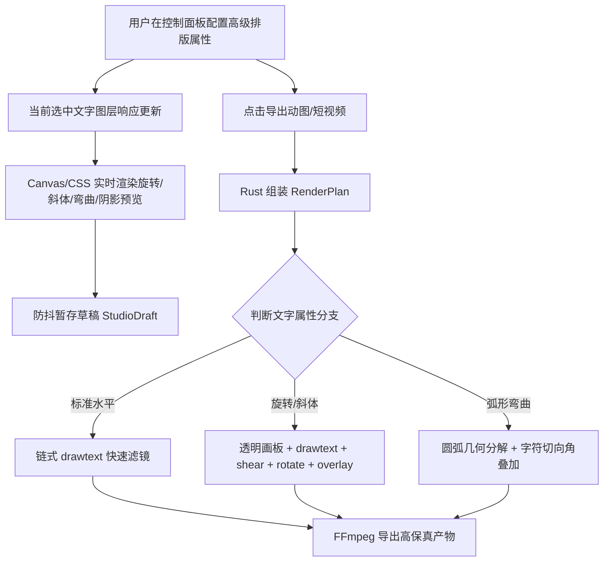

# 设计说明书：高级文字排版效果 (advanced-text-effects)

- 状态：merged
- Feature slug: advanced-text-effects
- 分支：feature/advanced-text-effects
- 负责人：Antigravity
- 日期：2026-10-22

## 1. 架构与交互设计

### 1.1 核心数据流



### 1.2 UI 控件布局设计

在侧边控制面板“文字图层”的样式调节区，在“描边与底框”下方新增：

1. **“旋转角度”节**：
   - 滑块显示当前角度（如 `45°`），范围 `-180° ~ 180°`；
   - 快捷按钮组：`0°` (重置), `-45°`, `-15°`, `+15°`, `+45°`, `90°`。
2. **“弧形弯曲”节**：
   - 弯曲度滑块：`-100 ~ 100`，指示标签：负数显示“向下凹 ◡”、0 显示“直线 —”、正数显示“向上拱 🌈”。
3. **“排版风格与立体阴影”节**：
   - 斜体切换按钮：`斜体 / 倾斜 𝐼`；
   - 阴影偏移滑块：`0px ~ 20px`（0 为无阴影）；
   - 阴影颜色拾色器：默认 `#000000`。

---

## 2. 数据结构设计

### 2.1 Rust 后端结构 (`src-tauri/src/lib.rs`)

```rust
#[derive(Debug, Clone, Deserialize, Default, PartialEq)]
#[serde(rename_all = "camelCase")]
pub struct TextOverlay {
    pub id: Option<String>,
    pub text: String,
    pub x: u32,
    pub y: u32,
    pub size: u32,
    pub color: String,
    pub stroke_width: Option<u32>,
    pub stroke_color: Option<String>,
    pub use_box: Option<bool>,
    pub box_color: Option<String>,
    pub box_opacity: Option<f64>,
    pub visible: Option<bool>,
    // 高级文字排版属性 (advanced-text-effects)
    pub rotation: Option<i32>,
    pub arc_radius: Option<i32>,
    pub is_italic: Option<bool>,
    pub shadow_offset: Option<u32>,
    pub shadow_color: Option<String>,
}
```

### 2.2 前端模型 (`src/lib/desktop.ts`, `src/lib/templates.ts`)

```typescript
export interface TextOverlay {
  id?: string;
  text: string;
  x: number;
  y: number;
  size: number;
  color: string;
  strokeWidth?: number;
  strokeColor?: string;
  useBox?: boolean;
  boxColor?: string;
  boxOpacity?: number;
  visible?: boolean;
  rotation?: number;
  arcRadius?: number;
  isItalic?: boolean;
  shadowOffset?: number;
  shadowColor?: string;
}

export interface CanvasTextLayer extends TextOverlay {
  id: string;
  visible: boolean;
}
```

---

## 3. FFmpeg 滤镜图生成算法

在 `build_filter_graph` 中对每个激活的文字图层进行多态派发：

1. **标准通道 (Fast Path)**：
   - 条件：`rotation.unwrap_or(0) == 0 && arc_radius.unwrap_or(0) == 0 && !is_italic.unwrap_or(false)`
   - 策略：直接追加到基础流的 `,drawtext=...` 链中；
   - 若 `shadow_offset > 0`，追加 `:shadowx=${offset}:shadowy=${offset}:shadowcolor=${shadow_color}`。

2. **旋转/斜体单画板通道 (Rotated / Sheared Path)**：
   - 条件：`arc_radius.unwrap_or(0) == 0 && (rotation != 0 || is_italic)`
   - 策略：
     - 构建透明画板：`color=c=black@0.0:s=${pad_w}x${pad_h}:d=${duration},format=rgba`；
     - 居中绘制带描边与阴影的文字：`drawtext=...:x=(w-text_w)/2:y=(h-text_h)/2`；
     - 若 `is_italic` 为真：追加 `,shear=shx=-0.22:c=none`；
     - 若 `rotation != 0`：追加 `,rotate=${rad}:c=none:ow=rotw(${rad}):oh=roth(${rad})`；
     - 叠加到视频当前流：`[current_stream][rot_pad]overlay=${cx}-w/2:${cy}-h/2:eof_action=pass[next_stream]`。

3. **弧形弯曲通道 (Curved Arc Path)**：
   - 条件：`arc_radius.unwrap_or(0) != 0`
   - 策略：
     - 依据字符数 $N$ 计算每个字符的偏移切向角 $\theta_k$ 与径向坐标 $(cx_k, cy_k)$；
     - 为每个非空格字符创建紧凑透明文字画板，绘制该字符并旋转 $\text{rotation} + \theta_k$；
     - 依次串联叠加至主画面对应圆弧位点，形成优美连续的拱门/笑脸环绕弧线。

---

## 4. 容错与边缘情况防护

1. **极端角度与尺寸容错**：
   - 画板尺寸使用文字估算尺寸的 1.8~2.5 倍余量，防止旋转或斜切时字符边缘被画板边界意外裁剪；
2. **纯空格或特殊字符**：
   - 空格字符跳过独立画板生成，避免无效滤镜节点消耗资源；
3. **无缝预览与回滚**：
   - 旋转、弧度滑块提供即时双击或按钮快速归零（`0°` / `0 弯曲`）；
   - 所有属性支持防抖保存至 localStorage 草稿。
