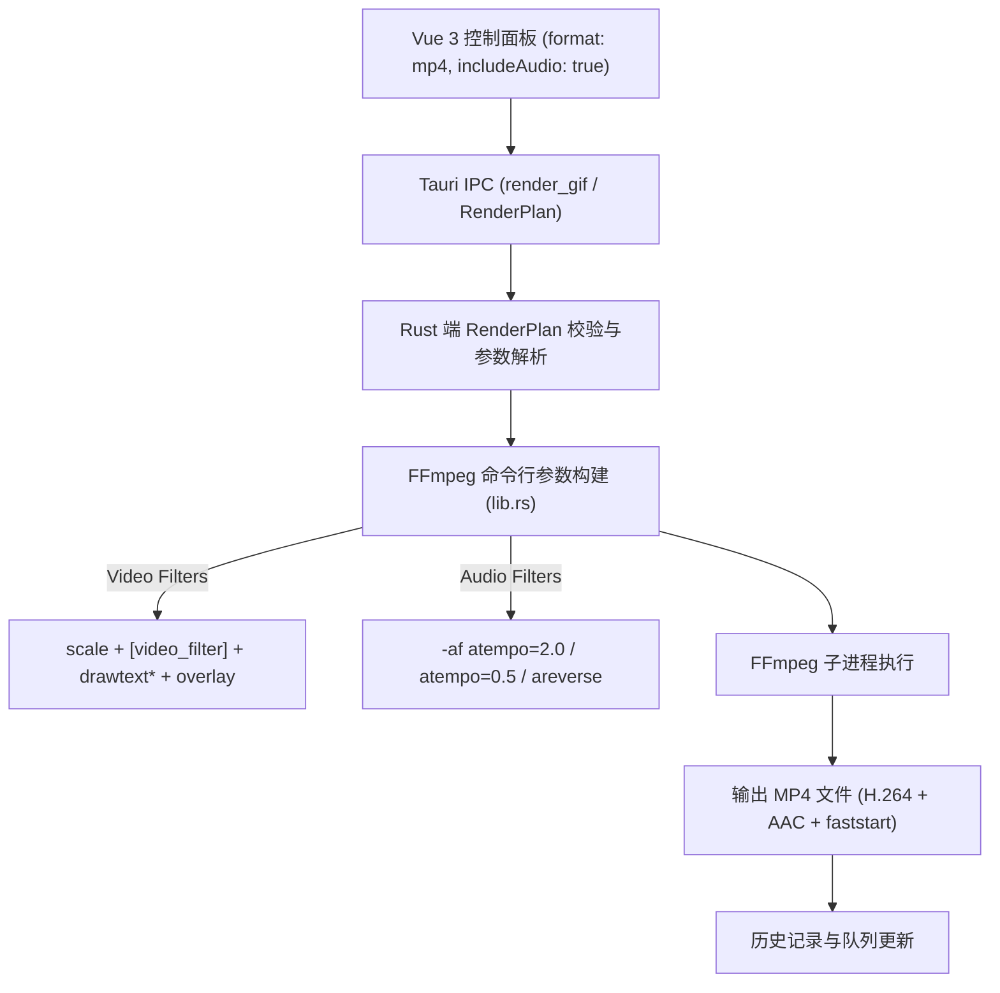

# 架构与设计规范：带音轨的短视频表情导出 (audio-video-export)

- 状态：implementing
- Feature slug: audio-video-export
- 分支：feature/audio-video-export
- 负责人：Antigravity
- 日期：2026-10-22

## 1. 架构总览



## 2. 数据结构演进

### 2.1 Rust 数据结构 (`src-tauri/src/lib.rs`)

```rust
pub struct RenderPlan {
    // ... 原有字段
    pub format: Option<String>,         // "gif" | "webp" | "avif" | "mp4"
    pub video_filter: Option<String>,   // "grayscale" | "speed2x" 等
    pub include_audio: Option<bool>,    // 新增：是否保留原声音频（默认 true）
}

impl RenderPlan {
    pub fn is_mp4(&self) -> bool {
        self.format.as_deref().unwrap_or("gif").eq_ignore_ascii_case("mp4")
            || self.output_path.to_lowercase().ends_with(".mp4")
    }
}
```

### 2.2 前端类型定义 (`src/lib/desktop.ts`, `src/lib/queue.ts`, `src/lib/templates.ts`)

```typescript
export type ExportFormat = 'gif' | 'webp' | 'avif' | 'mp4';

export interface RenderPlan {
  // ...
  format?: ExportFormat;
  includeAudio?: boolean;
}

export interface StudioDraft {
  // ...
  exportFormat: ExportFormat;
  includeAudio?: boolean;
}

export type QueueFormat = 'gif' | 'webp' | 'avif' | 'mp4';
export interface QueueItem {
  // ...
  format: QueueFormat;
  includeAudio?: boolean;
}
```

## 3. FFmpeg 参数组装规则

当 `plan.is_mp4()` 为 `true` 时：

1. **基础视频流**：
   - 包含已有 filtergraph：`scale`, `video_filter` (如 `hue=s=0` 或 `setpts`), `drawtext`, `overlay`；
   - 编码器：`-c:v libx264 -pix_fmt yuv420p -crf 23 -preset medium -movflags +faststart`；
2. **音频流处理**：
   - 若 `plan.include_audio.unwrap_or(true)` 为 `true`：
     - 流映射：`-map 0:v -map "0:a?"`（注意：FFmpeg 接受 `0:a?` 作为可选音频流，源文件没有音轨时自动忽略）；
     - 编码器：`-c:a aac -b:a 128k`；
     - 音频滤镜：
       - 若 `video_filter == "speed2x"`：追加 `-af atempo=2.0`；
       - 若 `video_filter == "slowmo"`：追加 `-af atempo=0.5`；
       - 若 `video_filter == "reverse"`：追加 `-af areverse`；
   - 若 `plan.include_audio` 为 `Some(false)`：
     - 追加 `-an`（纯静音视频）；
3. **输出限制**：
   - 保持 `-y` 覆盖输出，不使用 `-loop`（MP4 播放器默认通过客户端播放控制或网页 loop 属性实现循环）。

## 4. 前端交互与视觉规范

- **格式切换**：新增 `MP4 (微视频)` 药丸胶囊，激活时带有橘红渐变科技徽标；
- **原声控制**：新增 Switch 开关 `保留原声`，仅在格式选择为 `MP4` 时显示或高亮说明；
- **历史记录卡片**：检测扩展名为 `.mp4` 时使用 `<video>` 标签渲染缩略预览（可控制静音与播放），徽标显示亮橙红 `MP4`；
- **任务队列卡片**：清晰标记 `MP4` 与 `有声/静音` 状态。
