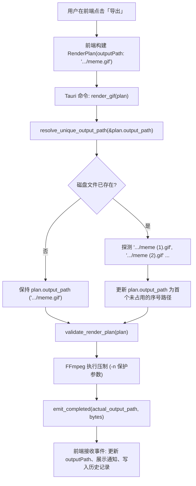

# 技术设计：同名导出自动顺延序号不覆盖 (auto-numbered-export)

- 状态：designed
- Feature slug：auto-numbered-export
- 分支：feature/auto-numbered-export
- 负责人：Meme Studio Team
- 日期：2026-10-22

## 1. 架构与数据流设计



## 2. 核心算法设计 (Rust)

在 `src-tauri/src/lib.rs` 中实现纯函数 `resolve_unique_output_path` 和辅助函数 `parse_numbered_stem`。

### 2.1 `parse_numbered_stem`
解析主文件名（file stem）是否带有系统序列号尾缀：
```rust
fn parse_numbered_stem(stem: &str) -> Option<(String, usize)> {
    if !stem.ends_with(')') {
        return None;
    }
    let open_paren = stem.rfind(" (")?;
    let inner_num_str = &stem[open_paren + 2..stem.len() - 1];
    let num = inner_num_str.parse::<usize>().ok()?;
    if num == 0 {
        return None;
    }
    let base_stem = stem[..open_paren].to_string();
    Some((base_stem, num + 1))
}
```

### 2.2 `resolve_unique_output_path`
```rust
pub fn resolve_unique_output_path(target: &Path) -> PathBuf {
    if !target.exists() {
        return target.to_path_buf();
    }

    let parent = target.parent().unwrap_or_else(|| Path::new(""));
    let ext = target.extension().and_then(|e| e.to_str()).unwrap_or("");
    let stem = target.file_stem().and_then(|s| s.to_str()).unwrap_or("output");

    let (base_stem, start_num) = if let Some(caps) = parse_numbered_stem(stem) {
        caps
    } else {
        (stem.to_string(), 1)
    };

    let mut counter = start_num;
    while counter < 10000 {
        let new_file_name = if ext.is_empty() {
            format!("{} ({})", base_stem, counter)
        } else {
            format!("{} ({}).{}", base_stem, counter, ext)
        };

        let candidate = if parent.as_os_str().is_empty() {
            PathBuf::from(new_file_name)
        } else {
            parent.join(new_file_name)
        };

        if !candidate.exists() {
            return candidate;
        }

        counter += 1;
    }

    target.to_path_buf()
}
```

## 3. 接口变更与校验调整

1. **`validate_render_plan`**：
   - 移除原来的：
     ```rust
     if output_path.exists() {
         return Err(app_error("OUTPUT_EXISTS", "输出文件已存在，请选择另一个路径。"));
     }
     ```
   - 保留输出扩展名校验（`.gif`, `.webp`, `.avif`, `.mp4`）与父目录存在性检查。
2. **`render_gif`**：
   - 在进入 `validate_render_plan` 之前，将 `plan.output_path` 通过 `resolve_unique_output_path` 规范化为唯一路径；
   - 随后的进程管理、FFmpeg 构建参数以及任务完成事件全部使用此唯一路径。

## 4. 前端队列规范调整 (`src/lib/queue.ts`)

在 `generateQueueOutputPath` 中，将重名追加逻辑从原有下划线连接 `_(${counter})` 改为符合系统规范的带空格圆括号 ` (${counter})`：
```typescript
while (existingPaths.has(candidate)) {
  candidate = `${normalizedBase}/${cleanName}_${timeTag} (${counter}).${format}`;
  counter++;
}
```
并在 `scripts/test-queue.mjs` 中更新对应断言。

## 5. 错误处理与安全性

1. **极端文件数保护**：上限限制为 10,000 次探测，防止死循环；
2. **权限与只读目录**：若父目录无写权限，FFmpeg 会正常报错并通过已有机制反馈给前端；
3. **并发竞态防覆盖**：FFmpeg 的 `-n` 参数依然保留，在任何情况下均不会破坏已有文件。
