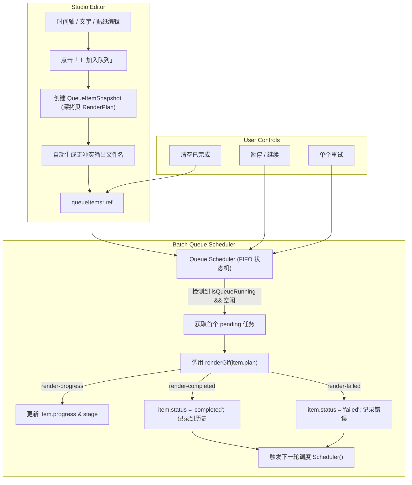

# 设计说明书：批量处理与导出任务队列 (batch-queue)

- 状态：proposed
- Feature slug: batch-queue
- 分支：feature/batch-queue
- 负责人：Antigravity
- 日期：2026-10-22

## 1. 总体架构与数据流



## 2. 数据结构设计 (`src/lib/queue.ts`)

```ts
export type QueueItemStatus = "pending" | "rendering" | "completed" | "failed" | "cancelled";

export interface QueueItem {
  id: string;                      // 唯一任务 ID (e.g. queue-1729580000-abcd)
  title: string;                   // 任务显示名称 (e.g. 影视片段 01.20s-03.50s)
  inputFileName: string;           // 源视频文件名
  timeRangeLabel: string;          // 01.20s ~ 03.50s
  format: "gif" | "webp";
  status: QueueItemStatus;
  progress: number;                // 0 ~ 100
  stageMessage: string;            // 正在分析调色板 / 正在编码
  outputPath: string;              // 最终文件路径
  outputBytes?: number;
  errorMessage?: string;
  plan: RenderPlan;                // 完整不可变导出计划快照
  createdAt: number;
}
```

## 3. 防冲突输出文件名生成规则

当用户点击“加入队列”时，自动生成独立的文件名：
```ts
export function generateQueueOutputPath(
  baseDir: string,
  inputFileName: string,
  startSecs: number,
  endSecs: number,
  format: "gif" | "webp",
  existingPaths: Set<string>
): string {
  const cleanName = inputFileName.replace(/\.[^/.]+$/, "").replace(/[^a-zA-Z0-9_\u4e00-\u9fa5-]/g, "_");
  const timeTag = `${startSecs.toFixed(1)}s-${endSecs.toFixed(1)}s`;
  let candidate = `${baseDir}/${cleanName}_${timeTag}.${format}`;
  let counter = 1;
  while (existingPaths.has(candidate)) {
    candidate = `${baseDir}/${cleanName}_${timeTag}_(${counter}).${format}`;
    counter++;
  }
  return candidate;
}
```

## 4. 调度器核心逻辑 (Scheduler State Machine)

1. **触发条件**：
   - 用户点击“开始批量导出”；
   - 当前正在渲染的任务完成或失败后自动递归调度；
   - 用户重试某失败任务。
2. **调度步骤**：
   - 检查 `isQueueRunning.value`，若为 `false` 则终止；
   - 检查当前是否有任务正处于 `status === "rendering"`，若有则等待当前任务事件回调；
   - 从 `queueItems` 中查找第一个 `status === "pending"` 的任务；
   - 若找不到，说明队列已全部执行完毕，将 `isQueueRunning.value = false`，弹出 Toast：“全部批量导出任务已完成！🎉”；
   - 若找到：
     1. 将其标记为 `status = "rendering"`, `progress = 0`；
     2. 监听 `render-progress` 事件，更新该项的 `progress` 与 `stageMessage`；
     3. 调用 `renderGif(item.plan)`；
     4. 监听 `render-completed`，更新为 `status = "completed"`, `outputBytes`，自动加入 `historyList`；
     5. 监听 `render-failed`，更新为 `status = "failed"`, `errorMessage`；
     6. 无论成功或失败，调用 `runNextInQueue()` 处理下一项。

## 5. UI 与视觉设计

### 5.1 底部操作栏 (`.actions-shelf`)
- 左侧增加：
  - `＋ 加入队列` 按钮（带有徽标指示当前队列待办数）；
- 中间/右侧：
  - `立即导出 (当前)`
  - `🚀 开始批量 (N)`（当队列中有 `pending` 任务时高亮提示）
  - 队列正在运行时变为 `⏸ 暂停批量` / `终止`。

### 5.2 抽屉第 4 Tab (`.queue-tab-content`)
- 抽屉标签：`📋 任务队列 (N)`
- 工具栏：
  - 队列状态统计：`待处理 3` · `进行中 1` · `已完成 2`
  - 操作按钮：`🚀 开始批量导出`、`🗑 清空已完成`、`清空队列`
- 任务卡片横排滚动条（`.queue-strip`）：
  - 格式胶囊标签（GIF / WebP）；
  - 状态气泡（排队中 黄色 / 渲染中 蓝色转圈 / 已完成 绿色打钩 / 失败 红色警告）；
  - 时间区间与输出路径提示；
  - 细长动态进度条；
  - 右侧按钮：在访达打开（完成时）、重新尝试（失败时）、移除任务（未完成时）。
