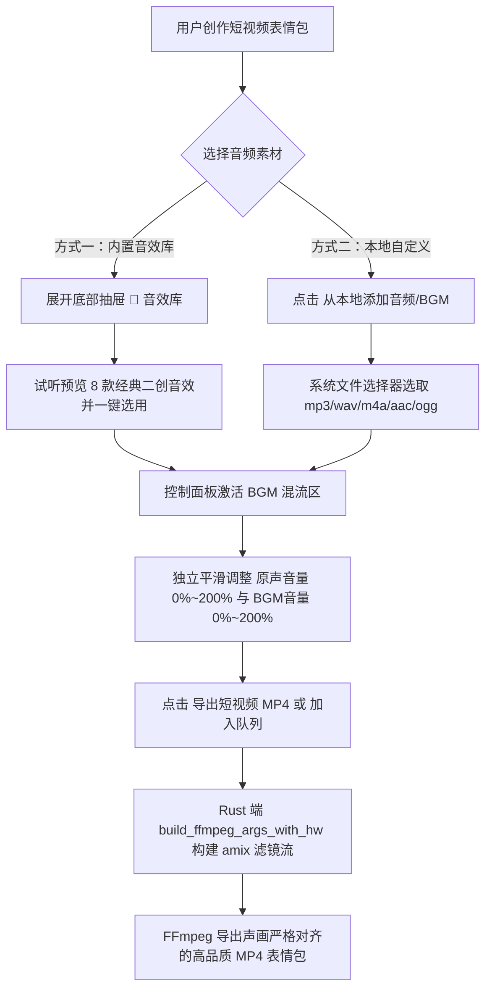

# 设计说明书：自定义背景音乐与音效混流 (bgm-audio-mixing)

- 状态：implementing
- Feature slug: bgm-audio-mixing
- 分支：feature/bgm-audio-mixing
- 负责人：Antigravity
- 日期：2026-10-22

## 1. 架构与交互设计

### 1.1 核心交互动线



### 1.2 UI 布局与视口规划

1. **抽屉面板（Drawer Tabs）**：
   - 增加第 5 个 Tab：`🎵 音效库`（与预设、模板、贴纸、历史、队列并列）；
   - 卡片栅格展示内置 8 款经典高频音效：
     - **消音哔哔 (Censor Bleep)**：台词爆粗瞬间遮蔽打码（时长 0.8s）；
     - **绝了清脆叮 (Crisp Ding)**：神转折、顿悟或发光瞬间（时长 0.8s）；
     - **震撼低音 (808 Boom)**：前方高能、突发惊变或全家震惊（时长 1.2s）；
     - **高能警报 (Danger Alarm)**：危险警告、大祸临头（时长 1.5s）；
     - **弹簧搞笑 (Boing Spring)**：滑稽出糗、反转动作（时长 0.8s）；
     - **欢呼喝彩 (Victory Cheer)**：点赞讽刺、庆祝胜利（时长 1.8s）；
     - **打脸啪 (Face Slap)**：瞬间打脸啪啪作响（时长 0.5s）；
     - **滑稽笑声 (Goofy Laugh)**：魔性鬼畜笑声（时长 1.5s）。
   - 每张音效卡片提供：
     - ▶ 试听 / ⏸ 暂停 播放按钮；
     - 选用状态高亮标识；
     - “一键选用”按钮。

2. **控制面板（Control Panel）**：
   - 在“导出设置”中，当格式为 MP4 时，展示 **背景音乐与音效** 专属控制节：
     - 已选音频信息提示（如：“已选用：消音哔哔 (0.8s)” 或 本地文件名）；
     - “选择本地音频” 与 “清除已选音效” 快捷按钮；
     - **源视频原声音量** 滑块（0% ~ 200%，步长 5%，默认 100%）；
     - **BGM/音效音量** 滑块（0% ~ 200%，步长 5%，默认 100%）。

---

## 2. 数据结构与接口设计

### 2.1 Rust 数据结构 (`src-tauri/src/lib.rs`)

```rust
#[derive(Debug, Clone, Deserialize, Serialize, Default)]
#[serde(rename_all = "camelCase")]
pub struct BgmOverlay {
    pub path: String,
    #[serde(default)]
    pub volume: Option<f64>,        // 默认 1.0 (100%)
    #[serde(default)]
    pub orig_volume: Option<f64>,   // 默认 1.0 (100%)
}

#[derive(Debug, Clone, Serialize)]
#[serde(rename_all = "camelCase")]
pub struct BuiltinSfx {
    pub id: String,
    pub name: String,
    pub category: String,
    pub path: String,
    pub data_url: String,
    pub duration: f64,
}
```

在 `RenderPlan` 中集成：
```rust
pub struct RenderPlan {
    // ... 原有字段
    #[serde(default)]
    pub has_audio: Option<bool>,
    #[serde(default)]
    pub bgm_overlay: Option<BgmOverlay>,
}
```

### 2.2 前端 TypeScript 接口 (`src/lib/desktop.ts`)

```typescript
export interface BgmOverlay {
  path: string;
  volume?: number;
  origVolume?: number;
}

export interface BuiltinSfx {
  id: string;
  name: string;
  category: string;
  path: string;
  dataUrl: string;
  duration: number;
}

export function getBuiltinSfx(): Promise<BuiltinSfx[]>;
export function pickAudioFile(): Promise<string | null>;
```

---

## 3. FFmpeg 混流管线构建算法

### 3.1 输入流索引动态映射

在执行 FFmpeg 转码时，输入流的顺序可能随贴纸叠加动态变化：
- **Input 0**：源视频 (`-i input.mp4`)
- **Input 1 (可选)**：贴纸图案 (`-loop 1 -i sticker.png`)
- **Input 2 (或 1)**：BGM/音效音频 (`-i sfx.mp3`)

因此，BGM 输入流的索引公式为：
```rust
let bgm_input_index = if plan.image_overlay.is_some() { 2 } else { 1 };
```

### 3.2 音频滤镜分支逻辑

在 `is_mp4()` 分支下：

1. **分支 A：有原声 + 有 BGM (`has_orig_audio && orig_vol > 0.0`)**
   - 原声音量滤镜：`[0:a]${orig_tempo_filter}volume=${orig_vol}[a0]`
   - BGM 裁剪与音量滤镜：`[${bgm_idx}:a]volume=${bgm_vol},atrim=0:${duration}[a1]`
   - 混流合并滤镜：`[a0][a1]amix=inputs=2:duration=first:dropout_transition=0[aout]`
   - 参数映射：`-map [vout] -map [aout] -c:a aac -b:a 128k`

2. **分支 B：无原声（或原声音量调至 0 或 include_audio 为 false）+ 有 BGM**
   - 仅对 BGM 挂载滤镜：`[${bgm_idx}:a]volume=${bgm_vol},atrim=0:${duration}[aout]`
   - 参数映射：`-map [vout] -map [aout] -c:a aac -b:a 128k`
   - **核心优势**：完全避免对缺失原声音轨的源视频引用 `[0:a]`，防止 FFmpeg 抛出 `Stream specifier matches no streams` 致命错误。

3. **分支 C：有原声 + 无 BGM**
   - 沿用成熟原逻辑：`-map 0:a? -c:a aac -b:a 128k`（如有加速挂载 `-af atempo`）。

4. **分支 D：无原声 + 无 BGM，或导出动图（GIF / WebP / AVIF）**
   - 统一输出 `-an`，完全剥离音轨，保证动图与无声音视频轻量化。

---

## 4. 容错与稳定性保证

1. **缺失音频检测与防御**：
   - `probe_media` 探测源视频是否存在 `a:0` 音频流；
   - Rust 端 `input_has_audio(plan)` 结合 `plan.has_audio` 与 `ffprobe` 本地探测，双重保险。
2. **音频时长严格对齐**：
   - 无论音效素材是 0.5 秒还是 30 秒，使用 `atrim=0:duration` 保证混音长度绝不超过视频画面截取长度，杜绝“视频结束了音频还在播”或 MP4 时长被拉长的严重体验问题。
3. **内置音频自包含分发**：
   - 8 款音效使用免版权高品质合成算法生成，单文件体积 15KB ~ 35KB，8 款总计仅 200KB；
   - 打包进应用 Resources/sfx 目录，完全离线免配置可用。
