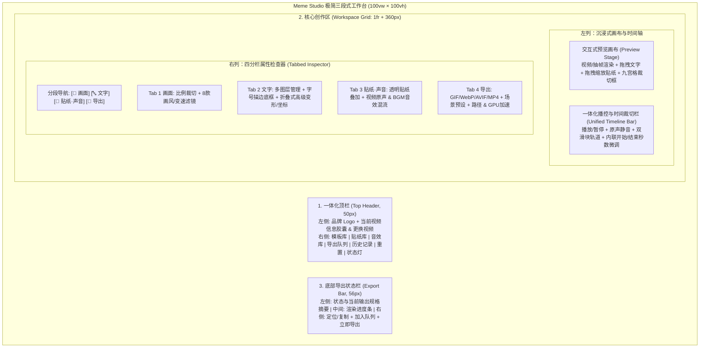

# 技术设计：极简创作工作台布局重构 (clean-studio-layout)

- 状态：merged
- Feature slug：clean-studio-layout
- 分支：feature/clean-studio-layout
- 负责人：Meme Studio Team
- 日期：2026-10-22

## 1. 整体页面架构对比与重构蓝图



## 2. 交互与状态设计 (`src/App.vue`)

### 2.1 新增 UI 导航与折叠状态
在不改变任何业务数据字段（`RenderPlan`、`StudioDraft` 等）的前提下，新增轻量视图状态：
```typescript
type InspectorTab = "canvas" | "text" | "media" | "export";
const activeInspectorTab = ref<InspectorTab>("canvas");
const showAdvancedText = ref(false);
const showExactCoords = ref(false);
```

### 2.2 智能指示器（Active Feature Dots）
为了让用户在切换 Tab 时依然清楚当前有哪些效果处于激活状态，在 4 个 Tab 按钮上提供状态点计算：
- **画面 Tab 激活点**：`useCrop || currentVideoFilter !== 'none'`
- **文字 Tab 激活点**：`useText`
- **贴纸·声音 Tab 激活点**：`(useImage && Boolean(imagePath)) || Boolean(bgmPath)`
- **导出 Tab 徽章**：直接展示当前选中的格式名称（如 `GIF`、`WEBP`、`AVIF`、`MP4`）

### 2.3 画布交互与 Tab 自动联动
- `startDragText` 触发时：自动设置 `activeInspectorTab.value = "text"`；
- `startDragImage` / `startResizeImage` 触发时：自动设置 `activeInspectorTab.value = "media"`；
- `startDragCrop` / `startResizeCrop` 触发时：自动设置 `activeInspectorTab.value = "canvas"`；
- 从贴纸抽屉选用贴纸 `applySticker` 时：自动切换至 `activeInspectorTab.value = "media"`；
- 从模板抽屉套用模板 `applyTemplate` 时：自动切换至 `activeInspectorTab.value = "text"`；
- 从音效抽屉选用音效 `applySfx` 时：自动切换至 `activeInspectorTab.value = "media"`。

### 2.4 抽屉开关辅助函数
统一顶栏抽屉入口行为：点击顶栏的「模板」「贴纸」「音效」「队列」「历史」按钮时，若当前抽屉已打开且处于同一 Tab 则关闭抽屉，否则打开抽屉并切换至目标 Tab：
```typescript
function toggleDrawerTab(tab: "history" | "templates" | "stickers" | "queue" | "sfx"): void {
  if (isDrawerOpen.value && drawerTab.value === tab) {
    isDrawerOpen.value = false;
  } else {
    drawerTab.value = tab;
    isDrawerOpen.value = true;
  }
}
```

## 3. 视觉与样式系统升级 (`src/styles.css`)

1. **移除冗余布局规则**：清理旧版 `.studio-sidebar` 198px 网格列及 `.page-intro` 巨型标题高度占用，`.studio-shell` 改为纵向三段式 Flex/Grid 布局（`52px` 顶栏 + `1fr` 主工作区 + `56px` 底栏）；
2. **卡片与分组减噪**：
   - 右侧检查器内部采用清晰的分组卡片（`.inspector-group`），控制项之间留白均匀（`10px~12px`）；
   - 高级文字变形与精确坐标微调采用精致的手风琴折叠条（`.collapsible-box`），默认收起，点击平滑展开；
3. **空状态引导增强**：当尚未导入视频时，画布中央展示可直接点击的导入大卡片（支持一键唤起 `chooseVideo`），无需用户去右侧栏寻找导入按钮。

## 4. 风险与兼容性评估

- **数据兼容**：`localStorage` 中的草稿、自定义模板、历史记录、批量队列数据结构零改动，老用户升级后无缝读取；
- **进程与安全**：不涉及 Rust 后端和 FFmpeg 参数构建变更，安全性与稳定性保持不变。
