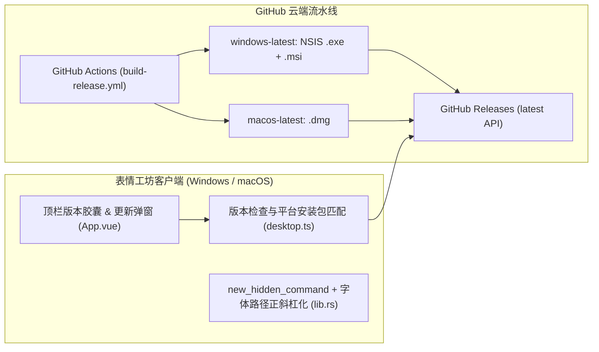

# 跨平台自动化构建、Windows 加固与远程更新检查设计文档 (Design)

- **状态**: ready-to-merge
- **分支**: `feature/cross-platform-release-updater`
- **日期**: 2026-10-23

## 1. 架构与数据流设计

## 2. 核心模块设计

### 2.1 Windows 隐藏控制台子进程 (`src-tauri/src/lib.rs`)
- 定义 `fn new_hidden_command<S: AsRef<std::ffi::OsStr>>(program: S) -> Command`：
  - 在 `#[cfg(target_os = "windows")]` 下调用 `cmd.creation_flags(0x08000000)` (`CREATE_NO_WINDOW`)。
  - 将 `probe_media`、`check_has_audio_stream`、`extract_video_frame`、`detect_hardware_acceleration`、`ffmpeg_supports_filter`、`render_gif`、`copy_file_to_clipboard`、`get_desktop_info` 中的 `Command::new` 全部替换为 `new_hidden_command`。

### 2.2 Windows 字体探测与正斜杠规范化 (`src-tauri/src/lib.rs`)
- `detect_system_font()` 在 Windows 下优先探测：
  - `C:/Windows/Fonts/msyh.ttc`（微软雅黑）
  - `C:/Windows/Fonts/msyhbd.ttc`（微软雅黑粗体）
  - `C:/Windows/Fonts/simhei.ttf`（黑体）
  - `C:/Windows/Fonts/simsun.ttc`（宋体）
  - `C:/Windows/Fonts/arial.ttf`
- 返回路径统一将 `\` 替换为 `/`，经 `escape_drawtext()` 处理后成为 `C\:/Windows/Fonts/msyh.ttc`，确保 FFmpeg `drawtext` 在 Windows 下零转义歧义。

### 2.3 远程更新检查与外部链接打开 (`src/lib/desktop.ts` & `src/App.vue`)
- 在 `src/lib/desktop.ts` 中新增：
  - `compareSemver(current: string, latest: string): number`（纯函数，支持 `v0.2.0` vs `0.1.0` 比较）
  - `checkGitHubUpdate(currentVersion: string, platform: string): Promise<UpdateInfo>`：请求 `https://api.github.com/repos/939740372/meme-generation/releases/latest`，自动挑选适合当前系统的安装包下载链接（Windows 优先选 `-setup.exe` / `.msi`，macOS 优先选 `.dmg`），若无匹配资产则回退到 Release 页面 URL。
  - `openExternalUrl(url: string): Promise<void>`：通过 `@tauri-apps/plugin-opener` 的 `openUrl` 在系统默认浏览器中打开安装包下载链接或 Release 页面。
