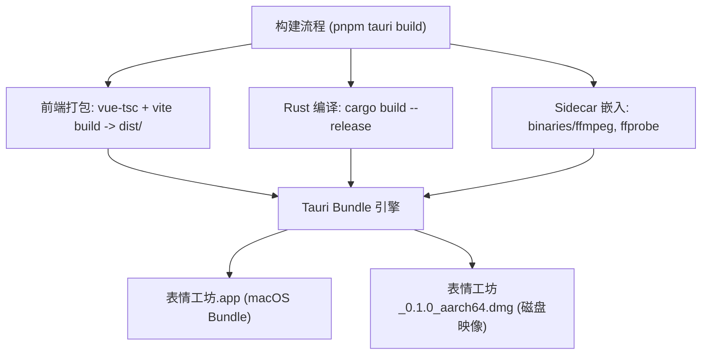

# 设计说明书：macOS DMG 桌面安装包构建与分发验收

- 状态：ready-to-merge
- Feature slug: desktop-packaging
- 分支：feature/desktop-packaging
- 负责人：Antigravity
- 日期：2026-10-22

## 1. 总体架构与包体结构



### 1.1 macOS App Bundle 内部文件层次设计

```text
表情工坊.app/
└── Contents/
    ├── Info.plist                     (元信息，如应用名、Bundle ID、图标路径等)
    ├── MacOS/
    │   ├── 表情工坊                    (应用入口主可执行文件)
    │   ├── ffmpeg-aarch64-apple-darwin (或 ffmpeg)
    │   └── ffprobe-aarch64-apple-darwin(或 ffprobe)
    └── Resources/
        ├── icon.icns                  (应用高清图标)
        └── ...
```

## 2. 二进制解析容错算法 (`resolve_binary`)

生产环境中不同版本的 Tauri 或打包工具有可能将 `externalBin` 放置在 `MacOS/` 或 `Resources/`，且可能保留 target triple 或截断为基础名称。因此解析算法设计如下：

```rust
fn resolve_binary(name: &str) -> PathBuf {
    // 1. 环境变量覆盖
    let variable = format!("{}_BINARY", name.to_ascii_uppercase());
    if let Ok(value) = env::var(&variable) {
        if !value.trim().is_empty() {
            return PathBuf::from(value);
        }
    }

    let target_triple = match (std::env::consts::OS, std::env::consts::ARCH) {
        ("macos", "aarch64") => "aarch64-apple-darwin",
        ("macos", "x86_64") => "x86_64-apple-darwin",
        ("windows", "x86_64") => "x86_64-pc-windows-msvc",
        ("linux", "x86_64") => "x86_64-unknown-linux-gnu",
        _ => "",
    };

    let binary_filename = if cfg!(windows) {
        if target_triple.is_empty() {
            format!("{}.exe", name)
        } else {
            format!("{}-{}.exe", name, target_triple)
        }
    } else if target_triple.is_empty() {
        name.to_string()
    } else {
        format!("{}-{}", name, target_triple)
    };

    // 2. 生产打包环境检查（基于当前可执行文件目录）
    if let Ok(current_exe) = env::current_exe() {
        if let Some(exe_dir) = current_exe.parent() {
            let candidates = [
                exe_dir.join(name),
                exe_dir.join(&binary_filename),
                exe_dir.join(format!("{}.exe", name)),
                exe_dir.join("../Resources").join(name),
                exe_dir.join("../Resources").join(&binary_filename),
                exe_dir.join("../Resources/binaries").join(name),
                exe_dir.join("../Resources/binaries").join(&binary_filename),
            ];
            for candidate in candidates {
                if candidate.is_file() {
                    return candidate;
                }
            }
        }
    }

    // 3. 源码开发环境候选路径
    let dev_candidates = [
        PathBuf::from("src-tauri").join("binaries").join(&binary_filename),
        PathBuf::from("binaries").join(&binary_filename),
        PathBuf::from("..").join("src-tauri").join("binaries").join(&binary_filename),
        PathBuf::from("src-tauri").join("binaries").join(name),
        PathBuf::from("binaries").join(name),
        PathBuf::from("..").join("src-tauri").join("binaries").join(name),
    ];
    for candidate in dev_candidates {
        if candidate.is_file() {
            return candidate;
        }
    }

    // 4. 回退到系统的 PATH
    PathBuf::from(name)
}
```

## 3. 构建配置设计 (`src-tauri/tauri.conf.json`)

确认 `bundle` 配置包含：
- `active: true`
- `targets: ["dmg", "app"]`
- `externalBin: ["binaries/ffmpeg", "binaries/ffprobe"]`
- `category: "Video"` 或 `"Entertainment"`
- `macOS`: 包含最低版本配置与框架声明。

## 4. 验收与冒烟测试策略

1. **构建产物存在性验证**：
   - 检查 `src-tauri/target/release/bundle/dmg/` 是否存在 `.dmg`；
   - 检查 `src-tauri/target/release/bundle/macos/` 是否存在 `表情工坊.app`；
2. **Sidecar 嵌入与权限验证**：
   - 进入 `表情工坊.app/Contents/MacOS/`，验证 `ffmpeg` 与 `ffprobe` 是否完整并具备执行权限；
   - 运行 `./ffmpeg -version` 确认其具备 `libfreetype` 与 `libwebp`；
3. **独立启动冒烟**：
   - 在脱离终端当前进程上下文环境中通过 `open` 启动 `.app`，验证界面与基础功能。
