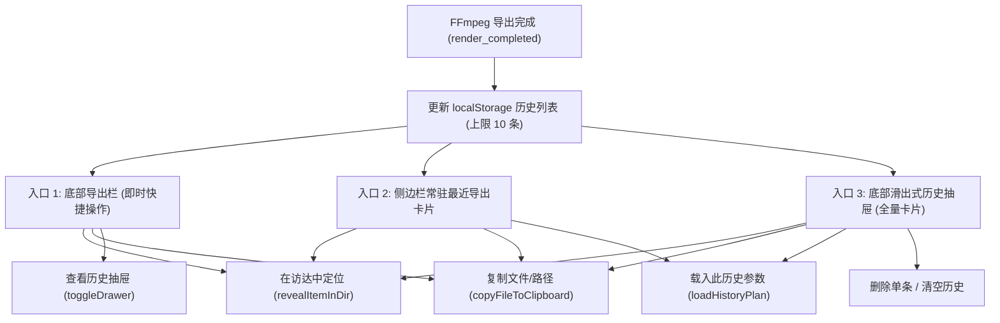

# 技术设计：最近导出历史与快捷操作

- 状态：merged
- Feature slug: export-history
- 分支：feature/export-history
- 负责人：待定
- 日期：2026-10-22

## 1. 架构与交互设计

### 1.1 总体布局与三大入口



### 1.2 视口空间保护设计 (1280 × 820)
1. **侧边栏 (Sidebar)**：
   - 现存结构：品牌区 (~60px) + 导航项 (~35px) + 闲置空间 (~580px) + 运行状态卡片 (~55px)；
   - 在导航项与运行状态卡片之间，嵌入 `.sidebar-history` 模块；
   - 仅展示最新的 1~2 张表情包微缩卡片，包含微型缩略图 (36×36px)、文件名、大小，并在 hover 或常态下提供定位、复制、载入 3 个微型图标按钮；
   - 提供「全部历史 (N) ↗」快捷按钮，点击触发底部抽屉展开。
2. **底部滑出式历史抽屉 (Collapsible Drawer)**：
   - 采用绝对定位/固定遮罩浮层，抽屉高度 260px，自工作区底部平滑上滑弹出；
   - 包含头部（标题、历史数量、一键清空按钮、关闭按钮）和横向可滚动的卡片流水线（Horizontal Card Strip）；
   - 卡片尺寸统一为 220px × 180px，清晰展示：大缩略图 (100px 高度)、文件名、体积 Badge、相对时间标签，以及底部 3 个快捷操作按钮；
   - 点击外部遮罩或按 ESC 键平滑收起。
3. **导出状态栏 (Export Bar)**：
   - 当 `status === 'completed'` 时，操作区除现有的「再次导出」外，新增「访达定位」、「复制文件」与「历史记录 (N)」小按钮组。

## 2. 数据结构设计

### 2.1 前端历史记录类型 (`ExportRecord`)

```typescript
export interface ExportRecord {
  id: string; // 唯一标识符，基于时间戳与随机串
  fileName: string; // 输出文件名，例如 "meme-01.gif"
  filePath: string; // 本地绝对路径，例如 "/Users/user/Desktop/meme-01.gif"
  outputBytes: number; // 文件大小（字节）
  timestamp: number; // 导出时间戳 (Date.now())
  previewUrl?: string; // Base64 缩略图 Data URL (懒加载或即时读取)
  plan: RenderPlan; // 导出时使用的完整渲染配置
}
```

### 2.2 本地存储管理 (`ExportHistoryStorage`)

- 键名：`meme_studio_export_history`
- 写入策略：
  - 新记录使用 `unshift()` 插入数组最前部；
  - 数组长度限制为 `MAX_HISTORY = 10`，超出部分丢弃；
  - 缩略图 `previewUrl`：考虑到 LocalStorage 单键 5MB 限制，若生成图较大，单条记录可持久化轻量元数据，缩略图通过 Rust 原子命令动态异步按需拉取，或限制仅持久化低分辨率 preview URL。

## 3. Rust 与 Tauri IPC 接口设计

### 3.1 访达高亮定位 (`reveal_item_in_dir`)
直接使用 `@tauri-apps/plugin-opener` 中的 `revealItemInDir(path: string | string[])`：
- 在 macOS 上调用 Cocoa API `[[NSWorkspace sharedWorkspace] activateFileViewerSelectingURLs:...]`；
- 在 Windows 上调用 `explorer.exe /select,path`；
- 行为：打开文件夹并自动高亮选中文件，且窗口置顶聚焦。

### 3.2 原生文件剪贴板复制 (`copy_file_to_clipboard`)
在 `src-tauri/src/lib.rs` 增加 Tauri command：
```rust
#[tauri::command]
fn copy_file_to_clipboard(path: String) -> CommandResult<()>
```
- **macOS 实现**：执行 `osascript -e 'set the clipboard to (POSIX file "...")'`，将真实文件引用写入剪贴板；
- **Windows 实现**：执行 `powershell -NoProfile -Command "Set-Clipboard -Path '...'"`；
- **前端回落**：同步执行 `navigator.clipboard.writeText(path)`，确保无论是文件还是路径都能被粘贴。

### 3.3 本地缩略图读取 (`read_file_as_data_url`)
在 `src-tauri/src/lib.rs` 增加 Tauri command：
```rust
#[tauri::command]
fn read_file_as_data_url(path: String) -> CommandResult<String>
```
- 检查文件存在性与大小（安全限制 < 15MB）；
- 使用 `fs::read` 读取二进制并通过 `base64` 编码为 `data:image/gif;base64,...`；
- 免去配置 Tauri assetProtocol 及其权限 scope 的繁琐风险，离线安全可用。

## 4. 错误处理与用户反馈

1. **文件已被移动或删除**：
   - 用户点击「在访达中打开」或「复制文件」时，若文件不存在，捕获异常并弹出 Toast「该文件已被移动或删除」；
   - 记录上显示「文件已丢失」标记。
2. **全局轻量 Toast 反馈组件**：
   - 在应用顶部正中提供轻量淡入淡出通知（3 秒自动消失）；
   - 反馈信息：
     - `已复制文件，可直接在微信/聊天软件中粘贴！`
     - `已在访达中显示文件`
     - `已载入历史参数，可直接在此基础上微调！`
     - `历史记录已清空`
