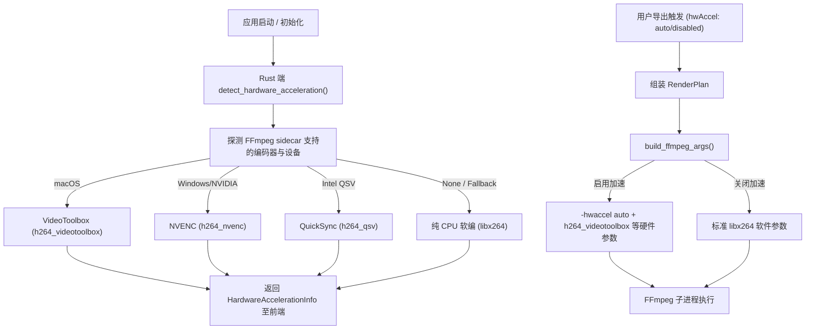

# 架构与设计规范：硬件加速编码策略探测 (hardware-acceleration)

- 状态：merged
- Feature slug: hardware-acceleration
- 分支：feature/hardware-acceleration
- 负责人：Antigravity
- 日期：2026-10-22

## 1. 架构总览



## 2. 数据结构演进

### 2.1 Rust 数据结构 (`src-tauri/src/lib.rs`)

```rust
#[derive(Debug, Clone, Serialize, Deserialize)]
#[serde(rename_all = "camelCase")]
pub struct HardwareAccelerationInfo {
    pub supported: bool,
    pub engine: String,       // "VideoToolbox" | "NVENC" | "QuickSync" | "VAAPI" | "None"
    pub encoder: String,      // "h264_videotoolbox" | "h264_nvenc" | "h264_qsv" | "libx264"
    pub description: String,  // 展示文案
}

pub struct RenderPlan {
    // ... 原有字段
    pub hw_accel: Option<String>, // "auto" | "enabled" | "disabled"
}
```

### 2.2 前端类型定义 (`src/lib/desktop.ts`, `src/lib/queue.ts`, `src/lib/templates.ts`)

```typescript
export interface HardwareAccelerationInfo {
  supported: boolean;
  engine: string;
  encoder: string;
  description: string;
}

export type HwAccelPolicy = "auto" | "disabled";

export interface RenderPlan {
  // ...
  hwAccel?: HwAccelPolicy;
}
```

## 3. 硬件编码参数映射规则

当启用硬件加速且检测到对应硬件编码器时：

| 硬件平台 | 编码器 | 质量映射参数 | 像素格式 |
|----------|--------|--------------|----------|
| macOS (Apple Silicon / Intel) | `h264_videotoolbox` | low: `-q:v 50`, medium: `-q:v 65`, high: `-q:v 75` | `yuv420p` |
| Windows / Linux (NVIDIA) | `h264_nvenc` | low: `-cq 28`, medium: `-cq 23`, high: `-cq 19` | `yuv420p` |
| Windows / Linux (Intel) | `h264_qsv` | low: `-global_quality 28`, medium: `-global_quality 23`, high: `-global_quality 19` | `nv12` |
| 通用回退 / 纯 CPU | `libx264` | low: `-crf 28`, medium: `-crf 23`, high: `-crf 18` | `yuv420p` |

- 解码端：在 `-ss` 与 `-i` 之前追加 `-hwaccel auto`；
- 秒开标志：保持 `-movflags +faststart`；
- 音频处理：完全保持 `0:a?` 容错混流与音频变速同步。

## 4. 前端交互与视觉规范

- 顶部状态栏或格式设置区增加科技感硬件加速胶囊徽章：
  - 加速可用时：`⚡ GPU 加速: VideoToolbox 已就绪`（青绿色/琥珀金光晕）；
  - 点击或下拉提供：`⚡ 自动 GPU 加速 (推荐)` 与 `⚙ 纯 CPU 软件压制` 切换；
- 切换为 CPU 软件模式时，徽标平滑变为静默灰度，状态即时生效。
