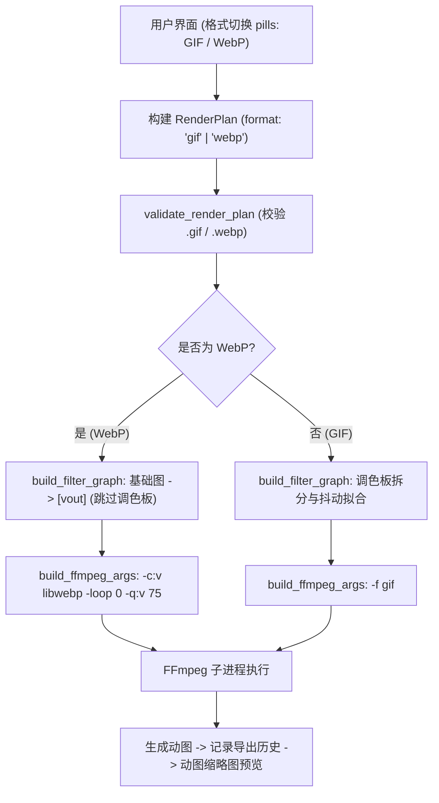

# 设计说明书：现代小体积动图 WebP 格式支持

- 状态：ready-to-merge
- Feature slug: modern-formats
- 分支：feature/modern-formats
- 负责人：Antigravity
- 日期：2026-10-22

## 1. 总体架构与数据流

本特性在现有 Tauri IPC 与 FFmpeg 转码执行流程上做精准分支：
1. **前端交互层**：状态 `exportFormat: Ref<'gif' | 'webp'>`。在参数面板中提供格式切换胶囊按钮；自动根据当前格式更新 `outputPath` 的扩展名；调用系统保存对话框时动态传入对应过滤规则；
2. **IPC 数据模型层**：在 `RenderPlan` 中携带 `format: "gif" | "webp"`；
3. **Rust 执行层**：根据格式构建差异化的 FFmpeg 滤镜图与转码指令：
   - GIF：`[composed]split...palettegen...paletteuse...[vout]` + `-f gif`；
   - WebP：`[composed][vout]`（直接打通） + `-c:v libwebp -loop 0 -q:v <quality>`。



## 2. 详细接口与数据结构

### 2.1 Rust 数据结构 (`src-tauri/src/lib.rs`)

```rust
#[derive(Debug, Clone, Deserialize)]
#[serde(rename_all = "camelCase")]
struct RenderPlan {
    input_path: String,
    output_path: String,
    start_secs: f64,
    end_secs: f64,
    crop: Option<CropArea>,
    output_width: u32,
    fps: u32,
    quality: Option<String>,
    text_overlay: Option<TextOverlay>,
    image_overlay: Option<ImageOverlay>,
    format: Option<String>, // 新增："gif" | "webp"
}

impl RenderPlan {
    fn is_webp(&self) -> bool {
        if let Some(fmt) = &self.format {
            if fmt.eq_ignore_ascii_case("webp") {
                return true;
            }
        }
        self.output_path.to_ascii_lowercase().ends_with(".webp")
    }
}
```

### 2.2 滤镜图构建逻辑重构 (`build_filter_graph`)

- 原逻辑：在末尾固定附加 `split` + `palettegen` + `paletteuse` 输出至 `[vout]`。
- 新逻辑：
```rust
fn build_filter_graph(plan: &RenderPlan) -> String {
    // 1. crop, scale, fps, drawtext... 生成 [base]
    // 2. 若有 image_overlay，拼接 overlay 生成 [composed]，否则 final_label 为 [base]
    // 3. 分支：
    if plan.is_webp() {
        // WebP 不需要调色板，直接将最终画面命名为 [vout]
        // 可以通过 ;[final_label]null[vout] 或者直接组织标签
        format!("{};{}[vout]copy", graph, final_label) // 或在组织 graph 时最终 label 直接为 [vout]
    } else {
        // GIF 保持原有的 palettegen / paletteuse
        format!(
            "{};{}split[gif][palette];[palette]palettegen=stats_mode=diff[p];[gif][p]paletteuse=dither={}[vout]",
            graph, final_label, dither
        )
    }
}
```

### 2.3 FFmpeg 命令行参数重构 (`build_ffmpeg_args`)

```rust
if plan.is_webp() {
    let q_value = match plan.quality.as_deref() {
        Some("low") => "55",
        Some("high") => "90",
        _ => "75",
    };
    args.extend([
        "-filter_complex".to_string(),
        filter_graph,
        "-map".to_string(),
        "[vout]".to_string(),
        "-c:v".to_string(),
        "libwebp".to_string(),
        "-q:v".to_string(),
        q_value.to_string(),
        "-loop".to_string(),
        "0".to_string(),
        "-an".to_string(),
        plan.output_path.clone(),
    ]);
} else {
    // 既有 GIF 逻辑
    args.extend([
        "-filter_complex".to_string(),
        filter_graph,
        "-map".to_string(),
        "[vout]".to_string(),
        "-an".to_string(),
        "-loop".to_string(),
        "0".to_string(),
        "-f".to_string(),
        "gif".to_string(),
        plan.output_path.clone(),
    ]);
}
```

### 2.4 TypeScript 前端接口扩展 (`src/lib/desktop.ts`)

```typescript
export interface RenderPlan {
  inputPath: string;
  outputPath: string;
  startSecs: number;
  endSecs: number;
  crop: CropArea | null;
  outputWidth: number;
  fps: number;
  quality?: "low" | "medium" | "high";
  textOverlay: TextOverlay | null;
  imageOverlay: ImageOverlay | null;
  format?: "gif" | "webp"; // 新增
}

export async function pickMediaOutput(
  defaultPath?: string,
  format: "gif" | "webp" = "gif",
): Promise<string | null> {
  requireDesktopRuntime();
  const filters =
    format === "webp"
      ? [
          { name: "WebP 动图", extensions: ["webp"] },
          { name: "GIF 动图", extensions: ["gif"] },
        ]
      : [
          { name: "GIF 动图", extensions: ["gif"] },
          { name: "WebP 动图", extensions: ["webp"] },
        ];

  return save({
    defaultPath,
    filters,
  });
}
```

## 3. UI 交互设计

### 3.1 格式切换胶囊 (Format Segmented Control)
放置在右侧导出面板“保存与导出”模块顶部，或紧邻质量预设栏：
```html
<div class="format-switch">
  <button :class="{ active: exportFormat === 'gif' }" @click="setExportFormat('gif')">
    GIF <span class="format-sub">经典通用</span>
  </button>
  <button :class="{ active: exportFormat === 'webp' }" @click="setExportFormat('webp')">
    WebP <span class="format-badge">推荐·小体积</span>
  </button>
</div>
```

### 3.2 格式与路径智能联动
- 当用户切换格式为 `webp` 时：
  - 如果 `outputPath` 已经有值（如 `/Users/xxx/video-meme.gif`），则自动将结尾的 `.gif` 改为 `.webp`；
- 当用户切换格式为 `gif` 时：
  - 自动将结尾的 `.webp` 改为 `.gif`。

### 3.3 历史记录卡片格式徽章
在侧边栏最近卡片和抽屉历史条目中：
- 如果路径以 `.webp` 结尾或 `record.plan.format === 'webp'`，展示鲜明的 `WEBP` 徽标；
- 如果为 `.gif`，展示稳健的 `GIF` 徽标。

## 4. 异常处理与边界情况

1. **用户输入错误扩展名**：`validate_render_plan` 检查若 `output_path` 扩展名既非 `.gif` 也非 `.webp`，明确抛出友好的中文错误提示；
2. **格式与后缀不一致**：若 `plan.format` 是 `webp`，但 `outputPath` 强行填了 `.gif`，Rust 校验时提示“格式与文件扩展名不匹配”，前端提交前通过 `ensureFormatExtension` 提前纠正；
3. **系统预览兼容**：macOS 访达和 Safari 原生支持 WebP 动图预览；
4. **历史抽屉向后兼容**：旧历史记录中未包含 `plan.format` 字段，默认解析 `filePath` 后缀或缺省为 `gif`，保证不发生前端反序列化崩溃。
