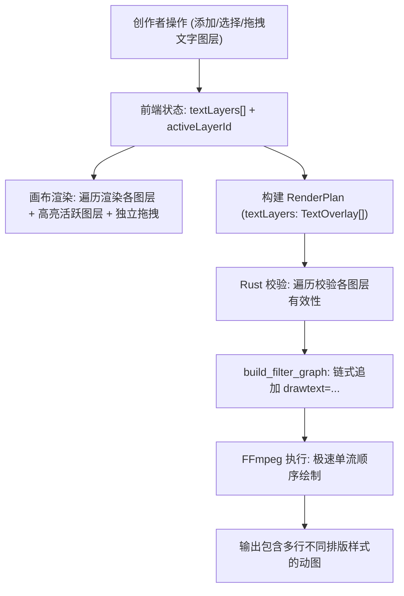

# 设计说明书：多文字图层支持

- 状态：proposed
- Feature slug: multi-text-layers
- 分支：feature/multi-text-layers
- 负责人：Antigravity
- 日期：2026-10-22

## 1. 总体架构与数据流



## 2. 接口与数据结构

### 2.1 Rust 端核心模型 (`src-tauri/src/lib.rs`)

```rust
#[derive(Debug, Clone, Deserialize)]
#[serde(rename_all = "camelCase")]
struct RenderPlan {
    input_path: String,
    output_path: String,
    start_secs: f64,
    end_secs: f64,
    crop: Option<CropArea>,
    output_width: u32,
    fps: u32,
    quality: Option<String>,
    text_overlay: Option<TextOverlay>, // 向后兼容旧单图层
    #[serde(default)]
    text_layers: Option<Vec<TextOverlay>>, // 新增：多文字图层
    image_overlay: Option<ImageOverlay>,
    #[serde(default)]
    format: Option<String>,
}

impl RenderPlan {
    fn active_text_layers(&self) -> Vec<&TextOverlay> {
        if let Some(layers) = &self.text_layers {
            if !layers.is_empty() {
                return layers.iter().filter(|l| !l.text.trim().is_empty()).collect();
            }
        }
        if let Some(single) = &self.text_overlay {
            if !single.text.trim().is_empty() {
                return vec![single];
            }
        }
        Vec::new()
    }
}
```

### 2.2 滤镜图链式构建算法 (`build_filter_graph`)

```rust
let active_texts = plan.active_text_layers();
if !active_texts.is_empty() {
    let fontfile_opt = detect_system_font();
    for text in active_texts {
        let mut drawtext_parts = Vec::new();
        if let Some(fontfile) = &fontfile_opt {
            drawtext_parts.push(format!("fontfile='{}'", escape_drawtext(fontfile)));
        }
        drawtext_parts.push(format!("text='{}'", escape_drawtext(&text.text)));
        drawtext_parts.push(format!("fontcolor={}", color_for_filter(&text.color)));
        drawtext_parts.push(format!("fontsize={}", text.size));
        drawtext_parts.push(format!("x={}", text.x));
        drawtext_parts.push(format!("y={}", text.y));

        let stroke_w = text.stroke_width.unwrap_or(0);
        if stroke_w > 0 {
            let stroke_c = text.stroke_color.as_deref().unwrap_or("#000000");
            drawtext_parts.push(format!("borderw={}", stroke_w));
            drawtext_parts.push(format!("bordercolor={}", color_for_filter(stroke_c)));
        }

        if text.use_box.unwrap_or(false) {
            let box_c = text.box_color.as_deref().unwrap_or("#000000");
            let box_op = text.box_opacity.unwrap_or(0.60);
            drawtext_parts.push(format!(
                "box=1:boxcolor={}@{:.2}:boxborderw=8",
                color_for_filter(box_c),
                box_op
            ));
        } else {
            drawtext_parts.push("box=0".to_string());
        }

        source.push_str(&format!(",drawtext={}", drawtext_parts.join(":")));
    }
}
```

### 2.3 前端 TypeScript 接口与模型 (`src/lib/desktop.ts`, `src/lib/templates.ts`)

```typescript
export interface TextOverlay {
  id?: string;
  text: string;
  x: number;
  y: number;
  size: number;
  color: string;
  strokeWidth?: number;
  strokeColor?: string;
  useBox?: boolean;
  boxColor?: string;
  boxOpacity?: number;
  visible?: boolean;
}

export interface RenderPlan {
  // ... 其他字段
  textOverlay: TextOverlay | null;
  textLayers?: TextOverlay[] | null;
}
```

## 3. UI 交互与组件设计

### 3.1 控制面板图层管理栏
在控制面板“03 叠加”中：
```html
<div class="text-layers-bar">
  <div class="text-layers-tabs">
    <button
      v-for="(layer, idx) in textLayers"
      :key="layer.id"
      class="layer-tab-pill"
      :class="{ active: activeLayerId === layer.id, muted: !layer.visible }"
      @click="selectLayer(layer.id)"
    >
      <span class="layer-tab-name">文字 {{ idx + 1 }}</span>
      <button class="layer-eye-btn" @click.stop="toggleLayerVisibility(layer.id)">
        {{ layer.visible ? '👁' : '✕' }}
      </button>
      <button
        v-if="textLayers.length > 1"
        class="layer-close-btn"
        @click.stop="deleteLayer(layer.id)"
      >
        ×
      </button>
    </button>
  </div>
  <button
    v-if="textLayers.length < 4"
    class="add-layer-btn"
    title="添加新文字图层（最多4个）"
    @click="addTextLayer"
  >
    ＋
  </button>
</div>
```

### 3.2 画布内多图层高亮指示与拖拽
- 画布中 `v-for="layer in visibleTextLayers"` 循环渲染；
- 点击某图层触发 `@pointerdown.stop="startDragLayer(layer.id, $event)"`；
- 当 `activeLayerId === layer.id` 时：
  - 添加 `.is-active-layer` 样式类，四周呈现 `1px dashed var(--accent)` 柔光微光框，清晰指引当前正在编辑哪段文字；
  - 拖拽手柄药丸显示当前图层的 `X / Y` 坐标。

## 4. 边界处理与容错

1. **图层至少保留一个**：当仅剩 1 个图层时，隐藏删除按钮，禁止全部删除；
2. **隐藏图层处理**：`visible === false` 的图层在画布中不渲染，在构建 `RenderPlan` 时自动滤除，不提交给 FFmpeg；
3. **空文字自动滤除**：仅纯空格字符的图层在导出时自动跳过；
4. **草稿恢复**：若从旧版草稿水合（仅包含单段文字），自动将其包装为带有 `layer-1` 的 `textLayers` 数组，保证向后平滑升级。
