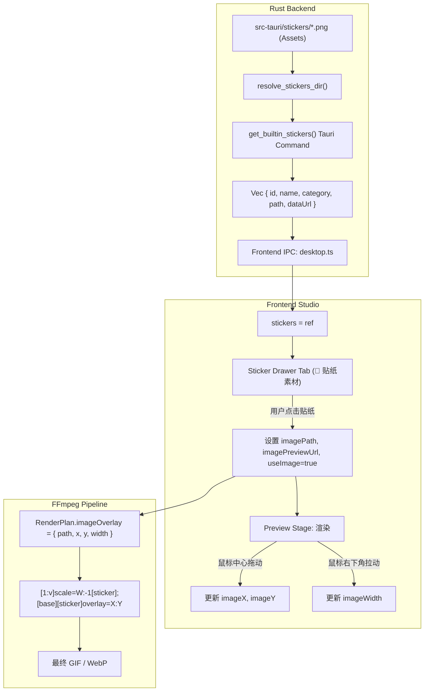

# 设计说明书：内置透明表情贴纸库 (sticker-library)

- 状态：proposed
- Feature slug: sticker-library
- 分支：feature/sticker-library
- 负责人：Antigravity
- 日期：2026-10-22

## 1. 总体架构与数据流



## 2. 贴纸资源资产规范

在 `src-tauri/stickers/` 放置 18 张透明 PNG 资源（尺寸 256×256，RGBA 8-bit），并维护静态清单：

| ID | 名称 | 分类 (Category) | 默认建议宽度 (px) | 梗图说明 |
|----|------|----------------|-------------------|----------|
| `deal_with_it` | 暴徒墨镜 | classic | 140 | 经典像素黑墨镜 Deal With It |
| `red_question` | 问号脸 | classic | 80 | 经典红色立体单问号 |
| `confused_questions` | 连环问号 | classic | 120 | 连续三个错落问号 ??? |
| `doge_face` | 旺柴狗头 | classic | 120 | 经典柴犬戏谑表情贴脸 |
| `panda_face` | 搞笑熊猫头 | classic | 130 | 经典黑白熊猫头 |
| `clown_nose` | 小丑红鼻 | classic | 60 | 经典马戏团小丑红鼻与表情点缀 |
| `sweat_smile` | 流汗黄豆 | emotion | 100 | 尴尬/阴阳怪气流汗笑脸 |
| `approved_stamp` | 绝赞及格印章 | emotion | 130 | 倾斜红色圆形绝赞盖章 |
| `rejected_stamp` | 离谱驳回印章 | emotion | 140 | 倾斜红色方框驳回盖章 |
| `anger_vein` | 暴青筋 | emotion | 70 | 动漫爆十字青筋符号 💢 |
| `sweat_drop` | 汗颜汗滴 | emotion | 60 | 巨大动漫冷汗滴 💧 |
| `sparkle_stars` | 崇拜闪闪 | emotion | 90 | 闪闪发光金色四角星 ✨ |
| `heart_eyes` | 色色心形眼 | emotion | 110 | 双眼冒出桃心表情 |
| `fire_flame` | 高能烈火 | emotion | 100 | 燃烧火焰特效 🔥 |
| `crying_tears` | 面条宽泪 | emotion | 120 | 瀑布动漫泪奔特效 |
| `thumbs_up` | 超赞大拇指 | emotion | 90 | 金色卡通点赞手势 👍 |
| `shout_bubble` | 尖角咆哮气泡 | bubble | 160 | 爆炸尖角对话框 |
| `dots_bubble` | 无语省略号气泡 | bubble | 150 | 椭圆对话框内嵌三个小圆点 |

## 3. Rust 接口与实现设计

### 3.1 数据结构
```rust
#[derive(Debug, Clone, Serialize, Deserialize)]
#[serde(rename_all = "camelCase")]
pub struct BuiltinSticker {
    pub id: String,
    pub name: String,
    pub category: String,
    pub path: String,       // 物理文件绝对路径，用于 FFmpeg 参数
    pub data_url: String,   // base64 Data URL，用于前端  极速预览
    pub default_width: u32,
}
```

### 3.2 路径解析策略 (`resolve_stickers_dir`)
1. 环境变量覆盖：`MEME_STUDIO_STICKERS_DIR`；
2. 打包运行态（macOS .app Bundle）：检查 `current_exe.parent().join("../Resources/stickers")`；
3. 开发态目录：检查 `PathBuf::from("src-tauri/stickers")`、`PathBuf::from("../src-tauri/stickers")`、`PathBuf::from("stickers")`；
4. 回退自解包兜底：若以上目录不存在（极端情况），从内嵌 byte 数组提取写入用户应用缓存目录（如 `~/.meme-studio/stickers`）。

## 4. 前端交互设计

### 4.1 抽屉面板集成
- 抽屉标签：增加“贴纸素材 (🎨)”（与“历史记录”、“排版模板”并列）；
- 分类栏：`全部 (18)`、`经典梗图 (6)`、`情绪表态 (10)`、`对话气泡 (2)`；
- 贴纸卡片：包含透明暗棋盘网格背景、悬浮缩放动画、点击即刻载入；
- 点击贴纸动作：
  1. `imagePath.value = sticker.path`；
  2. `imagePreviewUrl.value = sticker.dataUrl`；
  3. `imageWidth.value = sticker.defaultWidth`；
  4. 居中初始化坐标：`imageX.value = (media.width - sticker.defaultWidth) / 2`，`imageY.value = (media.height - sticker.defaultWidth) / 2`；
  5. `useImage.value = true`；
  6. 关闭抽屉并弹出轻量 Toast：“已添加贴纸「xxx」到画面中央”。

### 4.2 画布内缩放与拖拽交互
- 贴纸容器渲染 ``；
- 容器边框样式：悬浮或激活时展示 `1.5px dashed var(--accent)` 霓虹边框；
- 缩放手柄（Resize Handle）：
  - 位于贴纸外框右下角（`-4px, -4px`），图标为 `⤡`；
  - 绑定 `@pointerdown="startResizeImage"`；
  - 拖拽算法：
    $$\Delta W = (\text{pointerX} - \text{startX}) / \text{scaleX}$$
    $$\text{newWidth} = \text{clamp}(20, 1920, \text{initWidth} + \Delta W)$$
  - 贴图高度由 FFmpeg `scale=W:-1` 与前端 `width: W px, height: auto` 保持等比例不变形；
- 拖拽平移：
  - 贴纸主体区域绑定 `@pointerdown="startDragImage"`；
  - 平移算法计算 `newX, newY` 并限制在 `0 ~ media.width, 0 ~ media.height`。

### 4.3 侧边栏辅助控制
- 缩放快捷按钮：`50% (缩小)`、`100% (原始)`、`150% (放大)`；
- 尺寸微调输入框：`Width` 数字步进输入；
- 快捷入口：保留“选择自定义 PNG”，新加“🎨 贴纸素材库”。

## 5. 错误处理与容错

- 若读取贴纸文件失败，优雅降级返回占位图与提示错误；
- 若用户移动了自定义 PNG，前端继续展示占位状态并在导出前校验阻断并提示友好信息。
