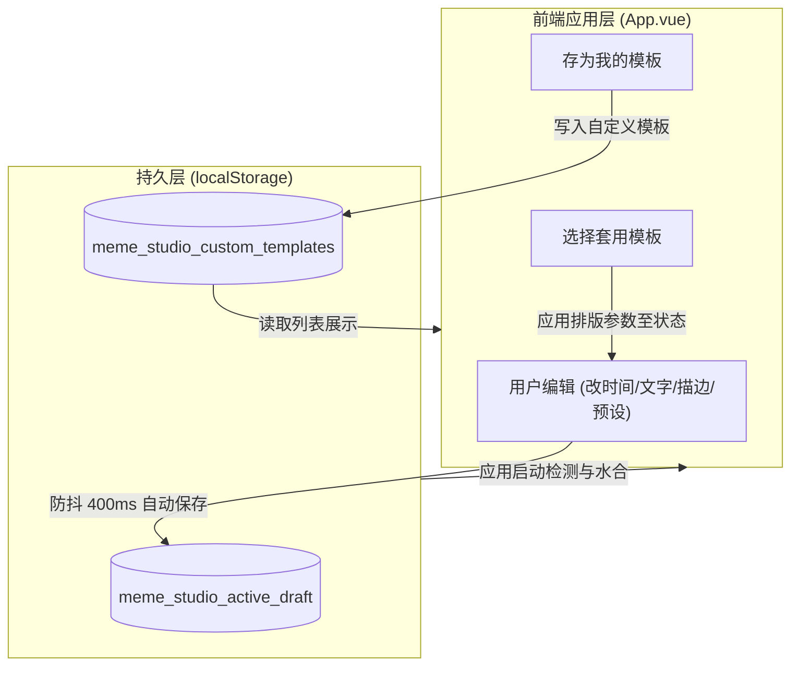

# 设计说明书：常用表情包模板与草稿暂存

- 状态：proposed
- Feature slug: templates-and-drafts
- 分支：feature/templates-and-drafts
- 负责人：Antigravity
- 日期：2026-10-22

## 1. 总体架构与数据流

本特性围绕“草稿自动持久化”与“排版模板引擎”构建：
- **草稿引擎 (Draft Engine)**：监听工作区状态，防抖 400ms 序列化为 `StudioDraft` 并写入 `localStorage`；启动时执行自检与水合（Hydration）。
- **模板引擎 (Template Engine)**：管理内置模板与用户自定义模板，提供 `applyTemplate` 与 `saveCurrentAsTemplate` 接口。



## 2. 核心数据结构设计

### 2.1 草稿数据结构 (`StudioDraft`)

```typescript
export interface StudioDraft {
  version: 1;
  updatedAt: number;
  inputPath: string;
  outputPath: string;
  startSecs: number;
  endSecs: number;
  useCrop: boolean;
  crop: { x: number; y: number; width: number; height: number };
  outputWidth: number;
  fps: number;
  quality: "low" | "medium" | "high";
  format: "gif" | "webp";
  selectedPresetId: string;
  useText: boolean;
  text: string;
  textX: number;
  textY: number;
  textSize: number;
  textColor: string;
  textStrokeWidth: number;
  textStrokeColor: string;
  textUseBox: boolean;
  textBoxColor: string;
  textBoxOpacity: number;
  useImage: boolean;
  imagePath: string;
  imageX: number;
  imageY: number;
  imageWidth: number;
}
```

### 2.2 模板数据结构 (`MemeTemplate`)

```typescript
export interface MemeTemplate {
  id: string;
  name: string;
  category: "builtin" | "custom";
  description: string;
  badge: string;
  // 文字样式配置
  textStyle: {
    defaultText?: string;
    size: number;
    color: string;
    strokeWidth: number;
    strokeColor: string;
    useBox: boolean;
    boxColor: string;
    boxOpacity: number;
    positionRatio: { x: number; y: number }; // 0.0 ~ 1.0 比例位置，跨分辨率适配
  };
  // 可选输出预设建议
  suggestedPresetId?: string;
  suggestedFormat?: "gif" | "webp";
}
```

### 2.3 内置官方模板定义 (`BUILTIN_TEMPLATES`)

1. **经典影视字幕条 (`builtin-subtitles-bar`)**
   - 描述：“居中白字 + 黑色半透明底条，院线名场面质感”
   - 徽标：“影视”
   - 样式：`size: 26`, `color: "#ffffff"`, `strokeWidth: 2`, `strokeColor: "#000000"`, `useBox: true`, `boxColor: "#000000"`, `boxOpacity: 0.65`, `positionRatio: { x: 0.5, y: 0.88 }`（居中偏底）
2. **顶部大字吐槽 (`builtin-top-banner`)**
   - 描述：“醒目黄色大字 + 纯黑描边，搞笑吐槽大白话”
   - 徽标：“吐槽”
   - 样式：`size: 32`, `color: "#ffe600"`, `strokeWidth: 3`, `strokeColor: "#000000"`, `useBox: false`, `positionRatio: { x: 0.5, y: 0.12 }`（居中偏顶）
3. **名场面震撼大字报 (`builtin-impact-headline`)**
   - 描述：“超粗体白字强黑边，视觉冲击力拉满”
   - 徽标：“大字报”
   - 样式：`size: 42`, `color: "#ffffff"`, `strokeWidth: 4`, `strokeColor: "#000000"`, `useBox: false`, `positionRatio: { x: 0.5, y: 0.78 }`

## 3. UI 交互设计

### 3.1 抽屉面板双 Tab 整合 (`history-drawer-panel`)
现有底部抽屉直接扩展为包含两项主功能：
- **`[🕒 导出历史 (N)]`**：浏览最近制作的动图，访达定位/复制文件；
- **`[📑 排版模板 (N)]`**：包含内置官方模板与自定义“我的模板”，每个卡片展示视觉预览小胶囊、名称、描述和“一键套用”按钮。

### 3.2 文字控制区“快速模板套用”与“存为模板”入口
在控制面板“文字叠加”区域：
- 标题行增加：
  - **`套用模板 ▾`**：快速呼出/打开模板抽屉或轻量浮动选择；
  - **`存为模板 ＋`**：将当前文字字号、描边、底框一键存为“我的模板”，弹出简洁的名称输入弹框；
- 顶部导航栏增加“重置工作区”动作，清空本地草稿并恢复到初始状态。

## 4. 容错与恢复策略

1. **自动草稿防抖**：采用 400ms 的 `debounce`，避免输入文字或拖拽选框时的重复写入；
2. **源文件失效降级**：若上次草稿中的本地视频路径在重新打开时无法被 `probeMedia` 访问（例如文件已移动），保留排版配置，提示“找不到上次的视频源”，允许用户直接点击“导入视频”替换视频即可，无需重新打字调样式；
3. **模板应用时的非破坏性原则**：套用模板时，若创作者已经输入了台词文本，**保留用户当前已输入的文字**，仅应用其样式与位置；若当前文字为空，才自动填入模板的默认文案。
