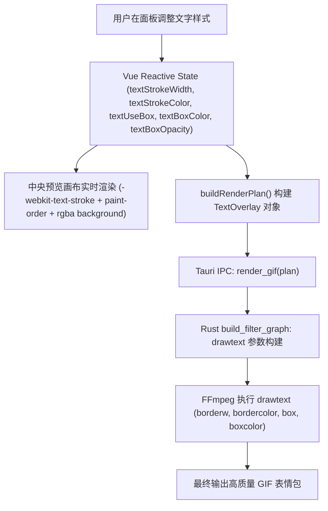

# 技术设计：文字描边与字幕底色条增强

- 状态：ready-to-merge
- Feature slug: text-styling-stroke
- 分支：feature/text-styling-stroke
- 负责人：待定
- 日期：2026-10-22

## 1. 架构与数据流设计



## 2. 数据结构扩展

### 2.1 TypeScript 接口 (`src/lib/desktop.ts`)

```typescript
export interface TextOverlay {
  text: string;
  x: number;
  y: number;
  size: number;
  color: string;
  strokeWidth?: number;       // 描边宽度 (0~12 px, 默认为 2)
  strokeColor?: string;       // 描边颜色 (默认为 "#000000")
  useBox?: boolean;           // 是否开启背景衬底框 (默认为 false)
  boxColor?: string;          // 底框颜色 (默认为 "#000000")
  boxOpacity?: number;        // 底框不透明度 (0.1 ~ 1.0, 默认为 0.6)
}
```

### 2.2 Rust 结构体 (`src-tauri/src/lib.rs`)

```rust
#[derive(Debug, Clone, Deserialize)]
#[serde(rename_all = "camelCase")]
struct TextOverlay {
    text: String,
    x: u32,
    y: u32,
    size: u32,
    color: String,
    stroke_width: Option<u32>,
    stroke_color: Option<String>,
    use_box: Option<bool>,
    box_color: Option<String>,
    box_opacity: Option<f64>,
}
```

## 3. FFmpeg drawtext 滤镜构建逻辑

在 `src-tauri/src/lib.rs` 的 `build_filter_graph` 中：

```rust
if let Some(text) = &plan.text_overlay {
    let mut drawtext_parts = Vec::new();
    if let Some(fontfile) = detect_system_font() {
        drawtext_parts.push(format!("fontfile='{}'", escape_drawtext(&fontfile)));
    }
    drawtext_parts.push(format!("text='{}'", escape_drawtext(&text.text)));
    drawtext_parts.push(format!("fontcolor={}", color_for_filter(&text.color)));
    drawtext_parts.push(format!("fontsize={}", text.size));
    drawtext_parts.push(format!("x={}", text.x));
    drawtext_parts.push(format!("y={}", text.y));

    // 描边构建
    let stroke_w = text.stroke_width.unwrap_or(0);
    if stroke_w > 0 {
        let stroke_color = text.stroke_color.as_deref().unwrap_or("#000000");
        drawtext_parts.push(format!("borderw={}", stroke_w));
        drawtext_parts.push(format!("bordercolor={}", color_for_filter(stroke_color)));
    }

    // 底框构建
    if text.use_box.unwrap_or(false) {
        let box_color = text.box_color.as_deref().unwrap_or("#000000");
        let box_opacity = text.box_opacity.unwrap_or(0.60);
        drawtext_parts.push(format!(
            "box=1:boxcolor={}@{:.2}:boxborderw=8",
            color_for_filter(box_color),
            box_opacity
        ));
    } else {
        drawtext_parts.push("box=0".to_string());
    }

    source.push_str(&format!(",drawtext={}", drawtext_parts.join(":")));
}
```

## 4. 前端画布 CSS 视觉映射

- **描边**：
  ```css
  -webkit-text-stroke: {displayStrokeWidth}px {textStrokeColor};
  paint-order: stroke fill;
  ```
  其中 `displayStrokeWidth` 按视频与视口缩放比缩放，最小保护 1px。
- **底框**：
  将 Hex 颜色与 Opacity 转换为 `rgba(r, g, b, a)`：
  ```css
  background: {textUseBox ? rgbaString : 'transparent'};
  padding: {textUseBox ? '4px 10px' : '0'};
  border-radius: 4px;
  ```
- **拖拽控制**：
  拖拽时手柄 Pill 显示坐标；文字与贴图各自保持独立的 pointerdown 逻辑。
