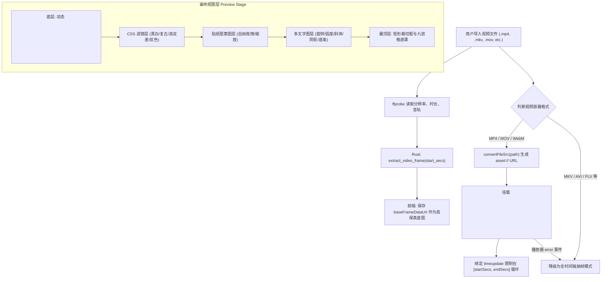

# 视频导入与画面实时预览设计 (Design)

## 1. 整体架构与数据流



---

## 2. 接口设计 (API & Commands)

### 2.1 Rust Command: `extract_video_frame`

```rust
#[tauri::command]
pub fn extract_video_frame(
    path: String,
    time_secs: f64,
    max_width: Option<u32>,
) -> CommandResult<String>
```

- **参数**：
  - `path`: 本地文件绝对路径
  - `time_secs`: 抽帧时间点（秒，允许小数，如 `2.35`）
  - `max_width`: 可选最大宽度，默认 640px，保持画面长宽比偶数对齐
- **内部 FFmpeg 调用**：
  ```bash
  ffmpeg -ss <time_secs> -i <path> -frames:v 1 -vf scale='min(640,iw)':-2 -f image2pipe -vcodec mjpeg -
  ```
- **返回**：`Ok("data:image/jpeg;base64,...")` 或 `Err(AppError)`

### 2.2 前端 API 封装 (`src/lib/desktop.ts`)

```typescript
export async function extractVideoFrame(
  path: string,
  timeSecs: number,
  maxWidth?: number
): Promise<string> {
  return await invoke<string>("extract_video_frame", {
    path,
    timeSecs,
    maxWidth,
  });
}

export function getVideoAssetUrl(filePath: string): string {
  if (!filePath) return "";
  return convertFileSrc(filePath);
}
```

---

## 3. 前端交互与状态设计

### 3.1 核心响应式状态
- `videoPreviewUrl = ref<string>("")`: 基于 `convertFileSrc` 的播放地址；
- `extractedFrameUrl = ref<string>("")`: 通过 FFmpeg 抽取的当前静帧 Data URL；
- `isPreviewPlaying = ref<boolean>(false)`: 预览播放器当前是否在播放中；
- `isNativeVideoSupported = ref<boolean>(true)`: 是否支持原生 `<video>` 播放；
- `videoElement = ref<HTMLVideoElement | null>(null)`: 视频元素引用；
- `previewCurrentTime = ref<number>(0)`: 播放器当前播放秒数。

### 3.2 循环与区间控制逻辑
- 挂载 `<video>` 元素时，设置：
  - `currentTime = startSecs.value`；
  - 监听 `timeupdate`：
    ```ts
    if (video.currentTime >= endSecs.value || video.currentTime < startSecs.value) {
      video.currentTime = startSecs.value;
      if (isPreviewPlaying.value) video.play();
    }
    ```
- 当用户调整 `startSecs` 或 `endSecs` 时，防抖重新校准播放器时间指针并抽帧更新背景图。
- 快捷键：空格键（Space）在鼠标位于画布区域或时间轴区域时一键切换播放/暂停。

---

## 4. 容错与降级设计

1. **非标准编码 / 格式降级**：
   当原生 `<video>` 触发 `@error`（例如 MKV 或无法识别的音频编码时），将 `isNativeVideoSupported.value` 置为 `false`，并提示“已启用全格式逐帧预览模式”，平滑回退到高清抽帧视图。
2. **防抖与子进程防打架**：
   拖拽时间轴滑块会连续高频触发 `update`，引入 120ms 防抖，并且维护单次抽帧在途标识，丢弃过期请求，避免子进程并发堆积。
