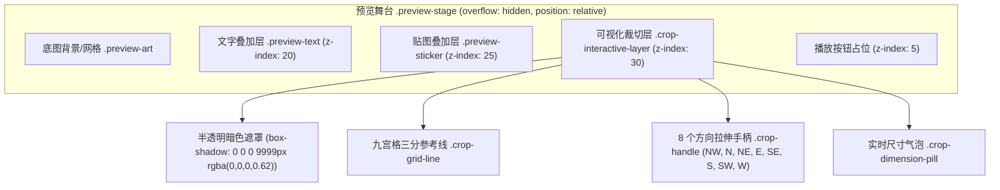

# 技术设计：可视化矩形裁切框与画布交互

- 状态：designed
- Feature slug: visual-crop-box
- 分支：feature/visual-crop-box
- 负责人：待定
- 日期：2026-10-22

## 1. 交互与视觉架构设计

### 1.1 画布 DOM 分层与层级管理

### 1.2 坐标转换与边界模型

- **源视频绝对空间**：
  - 范围：$X \in [0, W_m], Y \in [0, H_m]$
  - 裁切参数：$x, y, w, h \in \mathbb{N}$，受控于 `crop: reactive({ x, y, width, height })`
- **画布展示空间**：
  - 画布尺寸：$W_s = \text{stageSize.width}$, $H_s = \text{stageSize.height}$
  - 水平缩放比：$s_x = W_s / W_m$
  - 垂直缩放比：$s_y = H_s / H_m$
  - 选框在画布上的定位：
    - $\text{left} = x \cdot s_x$
    - $\text{top} = y \cdot s_y$
    - $\text{width} = w \cdot s_x$
    - $\text{height} = h \cdot s_y$

### 1.3 8 手柄微调机制

手柄定义及作用轴：
- `nw`: 同时调整左上角 $(x, y)$，宽高逆向变动 $(\Delta w = -dx, \Delta h = -dy)$；
- `ne`: 调整右上角 $(y)$ 及宽 $(w)$，高度逆向变动；
- `se`: 调整右下角宽高 $(\Delta w = dx, \Delta h = dy)$；
- `sw`: 调整左下角 $(x)$ 及高 $(h)$，宽度逆向变动；
- `n`: 调整上边缘高度与 $y$；
- `s`: 调整下边缘高度；
- `w`: 调整左边缘宽度与 $x$；
- `e`: 调整右边缘宽度；
- `center`: 平移整体选区位置，保持宽高不变。

每次 PointerMove 均执行越界保护与最小尺寸截断：
$$\text{width} = \max(24, \min(W_m - x, \text{newWidth}))$$
$$\text{height} = \max(24, \min(H_m - y, \text{newHeight}))$$
$$x = \max(0, \min(W_m - \text{width}, \text{newX}))$$
$$y = \max(0, \min(H_m - \text{height}, \text{newY}))$$

## 2. 接口与数据流设计

### 2.1 双向响应式流

1. **画布操作驱动**：
   - 用户在画布触发 `pointerdown` -> 挂载全局 `pointermove` 与 `pointerup`；
   - 移动时根据 delta 增量计算源视频像素值并直接更新 `crop.x`, `crop.y`, `crop.width`, `crop.height`；
   - Vue 响应式依赖自动促使控制面板各 `<input type="number">` 更新，并驱动计算属性 `cropDisplayLeft/Top/Width/Height` 实时更新。
2. **面板输入驱动**：
   - 用户在输入框键入数值时，触发 `@input` 事件；
   - 校验限制并写回 `crop` 对象，画布自动跟随重绘。
3. **快捷构图动作**：
   - `cropCenter()`：计算 $x = (W_m - w) / 2$, $y = (H_m - h) / 2$；
   - `cropSquare()`：取 $\text{side} = \min(W_m, H_m, w)$，并居中；
   - `cropReset()`：$x = 0, y = 0, w = W_m, h = H_m$。

## 3. 样式与视觉规范

- **选框外边框**：1.5px 实线或微虚线，使用 `--accent`（`#d7f46a`）电光青黄高亮；
- **暗色遮罩**：`box-shadow: 0 0 0 9999px rgba(0, 0, 0, 0.65)`；
- **九宫格三分线**：0.75px 细线，`rgba(255, 255, 255, 0.28)`；
- **控制手柄**：
  - 角手柄：8px × 8px 实心方块，边框 1px solid #10141a，背景 `--accent`；
  - 边手柄：12px × 5px / 5px × 12px 胶囊手柄，突出方向性；
  - 悬停动效：手柄微放大 1.25 倍并提高阴影亮度。
- **信息浮标**：半透明黑底胶囊标签，固定在裁切框顶部居中或内部角落，字号 10px monospace，呈现当前分辨率与坐标。
